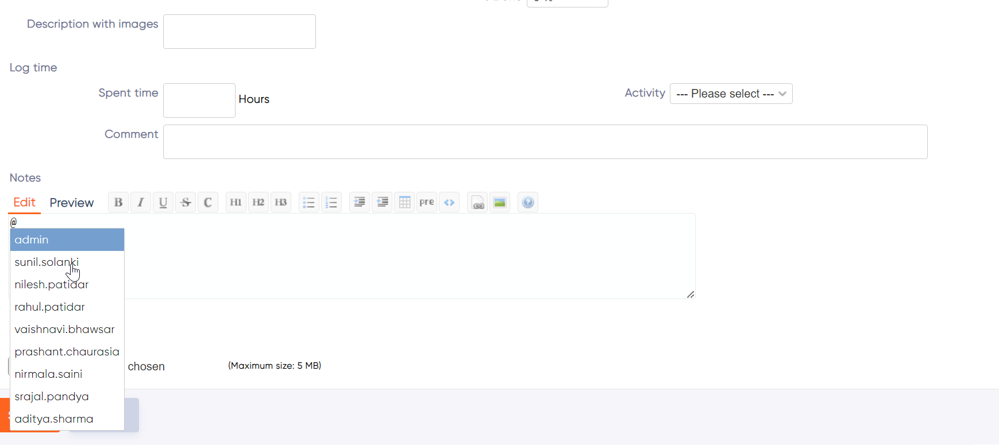
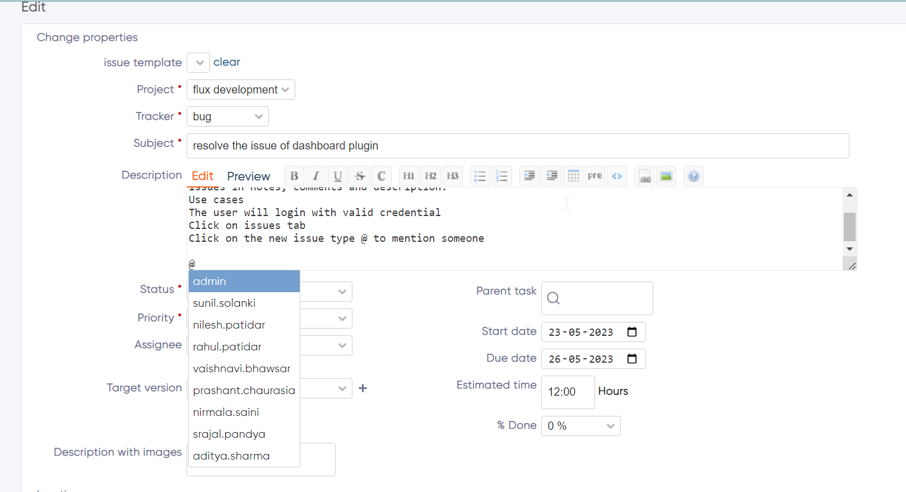
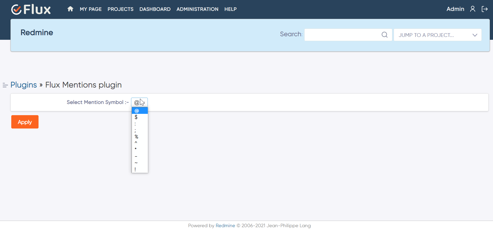

# Redmineflux Mentions Plugin

[](https://www.redmine.org)
[](https://www.ruby-lang.org)
[](https://opensource.org/licenses/GPL-2.0)

**Author:** Arean Narrayan ([@Arean82](https://github.com/Arean82))  
**Repository:** [https://github.com/Arean82/flux_mentions](https://github.com/Arean82/flux_mentions)  

The Mentions Plugin brings user mentions to Redmine, enabling collaboration and communication across your team. Users can mention colleagues in issue descriptions, journals/notes, and wiki pages, with autocomplete suggestions and email alerts sent to the mentioned users.

---





---

## 🚀 Key Features

* **Configurable Mention Symbol:** Customize the trigger symbol (`@`, `$`, `:`, `~`, `!`, `%`) from plugin settings.
* **Autocomplete Suggestions:** Autocomplete powered by Tribute.js suggests active project members as you type the symbol.
* **Instant Email Notifications:** Automatically dispatches email notifications to mentioned members when an issue is created, updated, or when wiki pages are edited.
* **Auto-linked Mentions:** Formats mentions into clickable user profile links in rendered markdown and textile.
* **Full Redmine 7.x & Rails 7 Compatibility:** Completely refactored for Zeitwerk autoloading using safe `to_prepare` hook loading.

---

## 📋 Compatibility

* **Redmine:** 5.0.x, 5.1.x, 6.0.x, and **Redmine 7.0.x**
* **Ruby:** 3.0, 3.1, 3.2, 3.3, 4.0
* Tested in production environments on Redmine 7.0.3

---

## 🛠️ Installation Instructions

> **Note:** Always run `bundle` and `rake` commands from the **Redmine root directory**, never from inside the plugin directory.

### 1. Clone the repository
Navigate to your Redmine `plugins` folder and clone the repository:

```bash
cd /data/redmine/plugins
git clone https://github.com/Arean82/flux_mentions.git
```

### 2. Configure Bundler & Dependencies
From your Redmine root directory:

```bash
cd /data/redmine
bundle config set --local without 'development test'
bundle install
```

### 3. Run Database Migrations
Run the plugin database migrations from the Redmine root directory:

```bash
bundle exec rake redmine:plugins:migrate RAILS_ENV=production
```

### 4. Restart Redmine
Restart your Redmine application server (e.g., Puma, Passenger, or systemd):

```bash
sudo systemctl restart redmine
```

---

## ⚙️ Configuration

1. Log in to Redmine as an administrator.
2. Go to **Administration** → **Plugins**.
3. Locate **Redmineflux Mentions plugin** and click **Configure**.
4. Choose your preferred mention trigger symbol (default: `@`) and save.

---

## 📄 License

This plugin is available under the GNU General Public License v2 (GPL-2.0).
